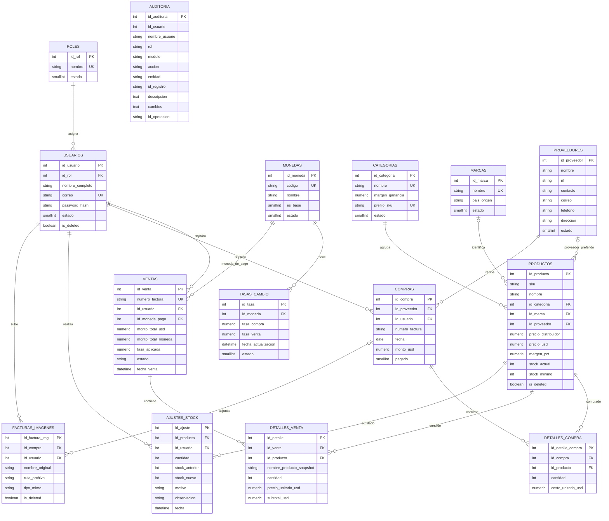

# Esquema sencillo de la base de datos

La aplicación usa PostgreSQL en su instalación habitual. Las tablas originales están
definidas en [database.sql](../database.sql); las migraciones agregan columnas, tablas y
protecciones adicionales. El dibujo muestra las relaciones principales y las tablas
operativas.

## Diagrama entidad-relación



`AUDITORIA.id_usuario` es intencionalmente **sin llave foránea**: el registro histórico
debe seguir existiendo aunque una cuenta se archive o ya no esté disponible. La tabla
es de solo lectura y guarda también el nombre y rol del usuario al momento del evento.

## Qué significa cada grupo

### Acceso y personas

- **`roles` → `usuarios`:** cada usuario tiene un rol. El nombre del rol se interpreta
  como Administrador, Gestor o Cajero.
- **`usuarios`:** correo, datos de contacto y hash de contraseña (nunca la contraseña
  original). `estado` permite desactivar la cuenta; `is_deleted` y
  `fecha_eliminacion` registran una baja lógica sin borrar su historial.

### Catálogo e inventario

- **`categorias`, `marcas`, `proveedores`:** describen los productos. `estado = 0`
  representa una categoría, marca o proveedor inactivo.
- **`productos`:** el registro de cada repuesto. `precio_distribuidor` es el costo;
  `precio_usd` es el precio de venta en dólares. Si `margen_pct` es nulo, el precio puede
  tomar el margen de la categoría; margen cero se usa para precio manual. `stock_actual`
  y `stock_minimo` permiten derivar Disponible, Bajo Stock o Agotado.
- **SKU:** cada producto tiene un SKU. En PostgreSQL la unicidad está limitada a
  productos no archivados; se puede reutilizar un SKU archivado si no lo usa otro
  producto activo.

### Ventas y cobros

- **`ventas`:** cabecera de una transacción. Conserva quién la registró, moneda de pago,
  tasa aplicada y totales en USD y en la moneda cobrada.
- **`detalles_venta`:** un renglón por producto vendido. El nombre guardado como
  `nombre_producto_snapshot` conserva la descripción de ese momento, aunque después se
  cambie el nombre del producto.
- Una venta tiene varios detalles. Cada detalle apunta a un producto; la anulación de
  una venta devuelve el stock según las reglas del backend.

### Compras, entradas y documentos

- **`compras`:** cabecera de la compra al proveedor, quién la registró, fecha, costo total
  y estado de pago.
- **`detalles_compra`:** productos y cantidades recibidas en cada compra. Registrar
  entradas suma existencias.
- **`facturas_imagenes`:** metadatos de un PDF o imagen de factura. El archivo vive en
  disco; `ruta_archivo` indica dónde está. Una factura puede estar asociada a una compra
  o quedar sin asociación.
- **`ajustes_stock`:** deja constancia de una corrección manual: diferencia,
  existencias antes/después, motivo, explicación y usuario responsable.

### Dinero y auditoría

- **`monedas`:** define USD y las monedas en que se puede cobrar. `es_base = 1` identifica
  la moneda base de los precios (USD).
- **`tasas_cambio`:** guarda un historial de tasas por moneda; la aplicación usa la tasa
  vigente para convertir la venta.
- **`auditoria`:** bitácora de cambios con fecha, persona, acción, entidad, descripción,
  diferencias y operación asociada. No tiene una relación foránea con `usuarios`.

## Relaciones importantes en palabras

```text
Rol ──< Usuario ──< Venta ──< DetalleVenta >── Producto
                    │                              │
                    └──< Compra ──< DetalleCompra >┘
                           │
                           └──< Factura escaneada

Categoría ──< Producto >── Marca
Proveedor ──< Producto (proveedor preferido)
Proveedor ──< Compra
Usuario ──< AjusteStock >── Producto
Moneda ──< TasaCambio
```

`──<` significa “uno a muchos”: por ejemplo, una categoría puede agrupar muchos
productos. `>──` conecta cada detalle con el producto al que se refiere.

## Tablas y columnas que se añaden después del esquema inicial

Las migraciones completan el esquema inicial:

| Migración | Cambios principales |
|---|---|
| `002_frontend.sql` | Márgenes, ubicación de producto, datos de proveedor, permisos de usuario; crea `compras`, `detalles_compra` y `facturas_imagenes`. |
| `003_sku_por_categoria.py` | Añade el prefijo/código de categoría utilizado para generar SKU. |
| `004_auditoria.sql` | Crea `auditoria` y bloquea modificación/borrado de sus registros. |
| `005_baja_logica.sql` | Agrega columnas de baja lógica a productos, usuarios y facturas; protege tablas contra borrado físico y hace único el SKU activo. |
| `006_gestor.sql` | Añade el rol Gestor, dirección del proveedor y `ajustes_stock`. |

Las columnas de baja lógica preservan datos e historial: archivar no equivale a borrar la
fila. Varias tablas también rechazan `DELETE` y `TRUNCATE` físicos en PostgreSQL.
Ejecuta las migraciones en el orden indicado en el [README](../README.md); no las
reemplaces por editar manualmente la base sin registrar el cambio.

## Cómo seguir los datos de una operación

- **Venta:** `ventas` es la cabecera y `detalles_venta` los renglones; cada renglón
  referencia `productos`.
- **Entrada de compra:** `compras` es la cabecera y `detalles_compra` indica qué
  productos y cuántos entraron; el backend actualiza el stock.
- **Corrección manual:** `ajustes_stock` documenta el cambio y su responsable.
- **Cambio importante:** `auditoria` permite encontrar quién lo hizo, cuándo y qué
  cambió.

Para ver los nombres exactos, tipos y restricciones de la estructura inicial, consulta
[database.sql](../database.sql); para las columnas posteriores, abre el SQL de la
migración correspondiente. Para ejemplos de lectura e inserción, consulta la
[guía de consultas e INSERT en PostgreSQL](./GUIA_SQL_POSTGRESQL.md).
