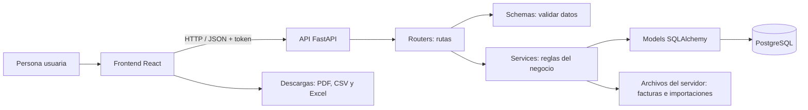
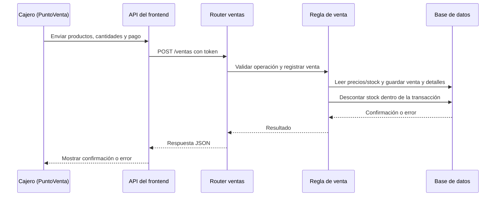

# Guía sencilla para entender el código

Esta aplicación administra inventario y ventas de repuestos. Tiene una interfaz web,
un backend que aplica las reglas del negocio y una base de datos PostgreSQL.

## El proyecto de un vistazo

- **Frontend:** muestra pantallas y envía solicitudes a la API. No debería decidir por
  sí solo si una operación está permitida.
- **Backend:** comprueba permisos y datos, ejecuta las reglas y habla con la base.
- **Base de datos:** conserva usuarios, productos, movimientos, ventas y registros.
- **Archivos:** algunos documentos (por ejemplo, facturas escaneadas) se guardan en
  disco; la base almacena sus datos y la ruta.
- **Descargas:** los PDF, CSV y Excel se preparan en la aplicación y se guardan desde
  el navegador.

## Cómo encontrar cada parte

| Si buscas... | Empieza por... | Para qué sirve |
|---|---|---|
| Arranque y rutas de toda la API | [app/main.py](../app/main.py) | Crea FastAPI, verifica la base y registra los routers. |
| Configuración y conexión a la base | [app/core/](../app/core/) y [app/database/session.py](../app/database/session.py) | Lee la configuración, crea sesiones y valida el esquema. |
| Inicio de sesión, token y permisos | [app/core/security.py](../app/core/security.py), [app/core/dependencies.py](../app/core/dependencies.py), [app/routers/auth.py](../app/routers/auth.py) | Valida credenciales, JWT y roles. |
| Reglas de productos, compras, ventas y usuarios | [app/services/](../app/services/) | Contiene operaciones que aplican las reglas del negocio. |
| Tablas y relaciones que usa Python | [app/models/](../app/models/) | Modelos SQLAlchemy que representan las tablas. |
| Forma de entrada y salida de la API | [app/schemas/](../app/schemas/) | Esquemas Pydantic para validar solicitudes y estructurar respuestas. |
| Rutas que consume una pantalla | [frontend/src/api/endpoints.ts](../frontend/src/api/endpoints.ts) | Agrupa las llamadas del frontend por tema. |
| Envío HTTP, token y errores | [frontend/src/api/client.ts](../frontend/src/api/client.ts) | Implementa el cliente común de la API. |
| Pantallas y navegación por rol | [frontend/src/App.tsx](../frontend/src/App.tsx) | Define rutas y paneles de Administrador, Gestor y Cajero. |
| Arranque de React | [frontend/src/main.tsx](../frontend/src/main.tsx) | Configura router, caché de consultas, autenticación y avisos. |
| Pruebas | [tests/](../tests/) | Pruebas del backend y de reglas importantes. |
| Definición SQL y cambios de esquema | [database.sql](../database.sql) y [migrations/](../migrations/) | Esquema inicial y migraciones posteriores. |

## Backend: qué hace cada carpeta

- **`app/routers/` — puertas de entrada.** Cada archivo declara rutas HTTP y coordina la
  operación. `auth.py` gestiona acceso; `usuarios.py`, usuarios; `productos.py`,
  inventario; `catalogo.py`, categorías, marcas y proveedores; `ventas.py` y
  `compras.py`, movimientos comerciales; `finanzas.py`, monedas y tasas; `facturas.py`,
  archivos de facturas; `reportes.py` y `reportes_gestor.py`, consultas; `auditoria.py`,
  bitácora; `importacion.py`, carga masiva.
- **`app/schemas/` — el formato de los datos.** Comprueba campos, tipos y restricciones
  de solicitudes y define qué información se devuelve. Si cambia el formato de una API,
  revisa aquí junto con el router y el frontend.
- **`app/services/` — reglas y operaciones.** Aquí se coordinan cambios que necesitan
  lógica compartida: autorización adicional, precios, autenticación, auditoría,
  recuperación, SKU e importación.
- **`app/models/` — representación de tablas.** `inventario.py` agrupa productos,
  categorías, marcas y proveedores; `ventas.py`, ventas y sus detalles;
  `compras.py`, compras, detalles, facturas y ajustes de stock; `usuarios.py`, roles y
  usuarios; `finanzas.py`, monedas y tasas; `auditoria.py`, la bitácora.
- **`app/core/` — utilidades transversales.** Configuración, fechas, dinero, seguridad y
  dependencias de autenticación/permisos.
- **`app/database/session.py` — sesiones y chequeo del esquema.** Usa SQLite para las
  pruebas y PostgreSQL para la aplicación real. En PostgreSQL comprueba que las tablas
  y columnas requeridas ya existan; las migraciones se ejecutan por separado.

La ruta típica de una solicitud es:

1. Un router recibe la solicitud HTTP.
2. Las dependencias validan el token y, cuando corresponde, el rol.
3. Un schema valida los datos recibidos.
4. El router o un service consulta y modifica modelos con una sesión de base de datos.
5. Se confirma la transacción y se devuelve una respuesta validada.

No todas las funciones pasan por un service separado; sigue las llamadas desde el router
concreto para conocer su implementación.

## Frontend: paneles y componentes

- **`frontend/src/auth/`** contiene el contexto de sesión, las pantallas de login y
  recuperación y la protección de rutas. El token se guarda en `sessionStorage`.
- **`frontend/src/admin/`** contiene pantallas del administrador: dashboard, usuarios,
  inventario, catálogo, proveedores, reportes y auditoría; `components/` guarda piezas
  reutilizadas como importación, facturas e historial.
- **`frontend/src/gestor/`** contiene el dashboard, entradas, inventario y reportes del
  gestor.
- **`frontend/src/cajero/`** contiene el punto de venta, inventario de consulta y ventas
  del cajero. `CartContext.tsx` mantiene el carrito durante la operación.
- **`frontend/src/shared/`** contiene el diseño común, controles, gráficos, utilidades
  para fechas/dinero, archivos PDF/CSV y la página informativa.
- **`frontend/src/api/`** mantiene las llamadas API, los tipos TypeScript y los hooks de
  caché. `queries.ts` ayuda a refrescar los datos tras cambios.

`RequireRole` limita qué rutas muestra la aplicación según el rol. Esto mejora la
experiencia, pero la autorización real también la debe hacer el backend.

## Ejemplo: seguir una venta

La base guarda el total en USD, el total en la moneda de pago y la tasa aplicada. La venta
y sus detalles se registran como una operación relacionada; si ocurre un error antes de
confirmar la transacción, no debe quedar una venta a medio guardar.

## Cómo orientarte al hacer un cambio

1. Busca la pantalla o el endpoint asociado a la funcionalidad.
2. Sigue la llamada: página → `frontend/src/api/endpoints.ts` → router.
3. Revisa permisos, schema y lógica de servicio/modelo.
4. Si cambia la estructura de datos, actualiza modelo y crea una migración compatible;
   no uses `create_all` como sustituto de migraciones en PostgreSQL.
5. Revisa o añade una prueba en `tests/` para el comportamiento cambiado.
6. Valida con `.\.venv\Scripts\python.exe -m pytest` y `cd frontend; npm run build`.

Para ver cómo poner en marcha la aplicación y las reglas de negocio, consulta el
[README del proyecto](../README.md). Para explorar los datos directamente, consulta la
[guía de consultas e INSERT en PostgreSQL](./GUIA_SQL_POSTGRESQL.md).
